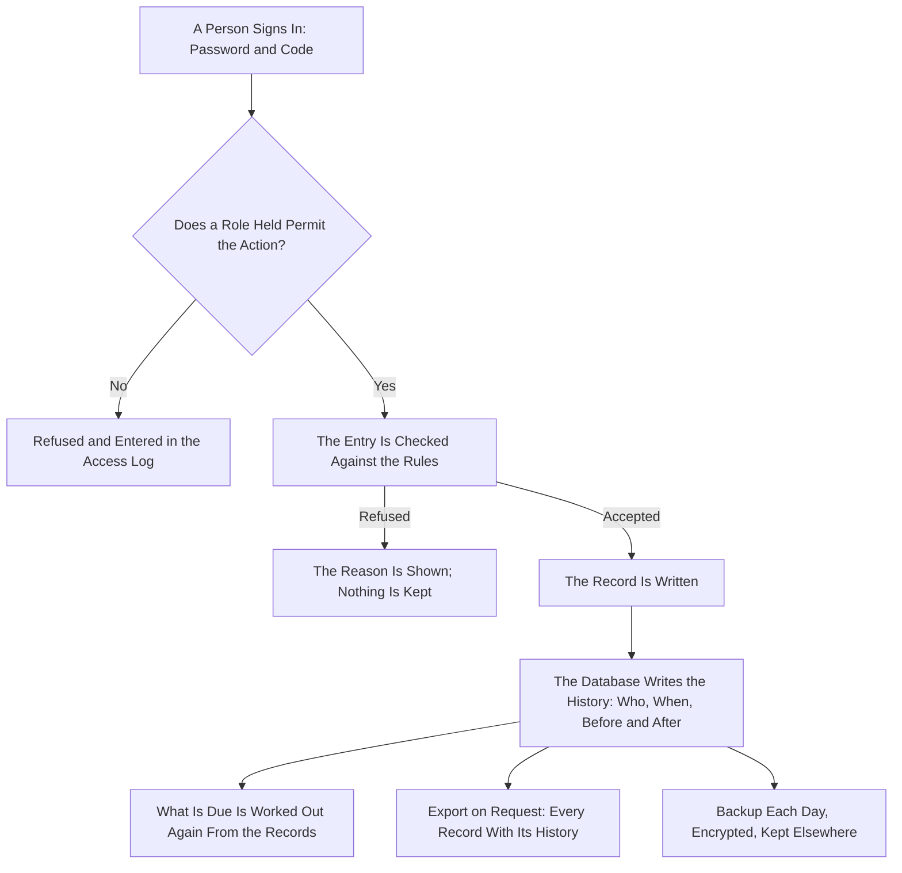

# Description of the System, for an Exposition

Step 8 of private beta. Date: 19 November 2026. REQ-175; AMC1 CAO.A.025; AMC1 CAO.A.100(f) point (d); CAO.A.035(e) and AMC1 CAO.A.035(e); OWASP ASVS 5.0, 13.1.1, 15.1.3.

An organisation that keeps its records in Airworthiness+ describes the system in its exposition and has it accepted by the Civil Aviation Authority. This is the text to start from. It describes the private beta slice as built. What CAP 562 Leaflet C-90 asks of such a description is **To Be Checked**: the leaflet could not be read in the build session.

## What It Is

A web application for the continuing airworthiness records of aircraft managed by a Part-CAO organisation: Part-ML aircraft in this version. It is used in a browser. Each organisation sees and changes its own records only.

## Main Functions

| Function | What It Does |
|---|---|
| Aircraft | The record of each aircraft; hours and cycles for the airframe, each engine and each propeller, entered as totals on a date and checked against the entries around them |
| Maintenance Programme | The tasks of each aircraft's programme with their limits in hours, cycles and calendar time; what is due and when, with the tolerance of the Minimum Inspection Programme where it applies; work done and its release to service |
| Airworthiness Directives | Each directive, the decision whether it applies to each aircraft with its basis, compliance, and what is next due |
| Maintenance Data | The data held, its revision, when its amendment status was last checked and when the next check is due |
| Airworthiness Review | The review against each point of ML.A.903, the certificate (CAA Form 15c), extensions, the copy to the Civil Aviation Authority, and the recency of review staff |
| Dashboard | One page of everything due across the organisation, read from the functions above and linking to each. Added 24 November 2026 |
| Staff | A record for each person of the organisation, whether or not they sign in, and for those who have left, with the day their record is kept until. Added 24 November 2026 |
| Customers | A record for each owner or operator, and the aircraft each owns. Added 24 November 2026 |
| Settings | The organisation's name and address, the approvals it holds, how close a limit must be to show as Due Soon, and its default limits for a deferred defect. Added 24 November 2026 |
| Records | Import from paper or spreadsheet with a verification report; export of an aircraft's or the organisation's whole record; the Problem Log |

Every calculated figure can be opened to show the rule, the inputs and the source reference it came from: what is next due under a programme or a directive, the dates of a review certificate, the copy to the Civil Aviation Authority, the recency of review staff and the 30 days for a release to be in the records. A date that was recorded and not calculated says so. A list such as the Fleet shows the figure and links to the page that opens it.

## How Records Are Kept

- Nothing is deleted. A wrong entry is superseded by a new one, and both remain.
- Every change is written to a history by the database itself: who, when, what changed, the value before and after. The application cannot alter or remove history, and nor can the owner of the tables without it showing: each entry carries a hash chained to the one before.
- A certificate's serial is given by the database, once, and never reused, including after a restore from backup.
- Dates that matter under the regulation are United Kingdom dates with no time. The time of each entry is kept in Coordinated Universal Time.

## How Records Are Read

On the pages, by aircraft or by subject. By export at any time: a ZIP file of JSON and CSV holding every record and its whole history, which describes itself and can be checked against the system (`python -m django verify_export`). Nothing is held in a form only this software can read.

## Who Is Authorised

Each person has their own account. Sign-in needs a password and a code from an authenticator application. What each person may do is set by role:

| Role | In Short |
|---|---|
| Administrator | Manages users and the organisation record; does not change airworthiness records |
| Continuing Airworthiness Manager | Changes programmes, decides whether directives apply, records work and data, extends certificates, imports records |
| Airworthiness Review Staff | Carries out reviews and issues certificates, when on the review staff record and recent |
| Planning and Records | Adds aircraft, enters hours and cycles, records work, compliance and data |
| Read Only | Views |

The full matrix is in `design-system/Decisions.md`, Roles and Permissions. Every refused action is logged. How the organisation gives and removes access is in `user-administration.md`.

## Security

- Each organisation's records are separated in the database itself, not only in the pages.
- Connections are encrypted. The service asks nothing of any other site and sends nothing to one.
- Sign-in is locked after 5 failures for 15 minutes; a session ends after 30 minutes without use and after 12 hours whatever happens.
- The measures are assessed against OWASP ASVS 5.0 Level 2 (`assurance/asvs.md`) and the threat model (`architecture/threat-model.md`). An external penetration test comes before any customer's records are held.

## What the Service Connects To

Its own database, and nothing else. No user can make it connect anywhere. It sends no email. Backups leave the server encrypted, to storage elsewhere.

## What Takes Time or Resources

| Function | Why | How It Is Kept in Bounds |
|---|---|---|
| Sign-in | A password is checked by a deliberately slow calculation | A name is locked after 5 failures; rate limits at the reverse proxy |
| Import | Every row makes records | A file is at most 1 megabyte and 2,000 rows |
| Export of an organisation | Reads every record and its history | Run by a signed-in user with the right to export, and logged. No more than 6 in an hour for each organisation |

## Backup

Daily, encrypted, kept away from the server, with a restore tested and recorded (`backup-and-restore.md`). The most that could be lost is 24 hours of entries; the service is restored by the next working day. Both are proposed figures.

## The Flow of a Record

A bulk load from paper or a spreadsheet follows the same path, row by row, and is kept whole or not at all. Each value it loaded is then checked against its source by a person, and the report says who checked it and when.

## Training

Sources: CAO.A.035(e), under which the organisation assesses and records the qualification of all its personnel; and AMC1 CAO.A.035(e), under which competence is assessed before unsupervised work, and initial and recurrent training is given and recorded. Both read in the UK text on 19 November 2026. CAP 562 Leaflet C-90 names training among the contents of the description of a computer system; that is from our notes of the leaflet and is To Be Checked against its current issue.

Training in the system is the organisation's to give and to record. The system holds no training records and does not know who has been trained. **By Hand:** the Administrator gives a person access only once the organisation is satisfied they are competent to use it for their role, and the organisation keeps the record of that with its other personnel records.

What a person needs to know before they use the system without supervision:

| Who | What |
|---|---|
| Everyone | Signing in with a password and a code. A first password is changed at first sign-in and works for 7 days. An account is one person's and is never shared: every entry carries the name of who made it |
| Everyone | Nothing is deleted. A wrong entry is put right by a further entry, and the history keeps both |
| Everyone | How to read a figure: what Due Soon, Overdue and Within Tolerance mean, the organisation's own Due Soon limits, and how to open a figure to see its rule, its inputs and its source |
| Everyone | Anything that looks wrong goes in the Problem Log, with what was seen. The system is an aid: the person remains responsible for the decision |
| Planning and Records | Hours and cycles are entered as totals on a date, for the airframe, each engine and each propeller. An unusual increase is confirmed, and a wrong entry is corrected by an entry that names it |
| Planning and Records | Recording work with its certificate of release to service, and the day the release was entered in the records. Recording compliance with a directive. Recording maintenance data, a new revision and an amendment check |
| Continuing Airworthiness Manager | All of the above. Setting up a programme and its tasks, and what the tolerance of the Minimum Inspection Programme does to a due date. Deciding whether a directive applies, with the basis written down |
| Continuing Airworthiness Manager | Extending a certificate, with each condition of ML.A.901(c) confirmed. Loading records in bulk, and the check of each loaded value against its source; hours and cycles are checked by a second person |
| Airworthiness Review Staff | Carrying out a review point by point with the evidence sampled, findings and their closure, and what stops a certificate being issued. What their own recency rests on and when it lapses. Voiding a certificate. The copy to the Civil Aviation Authority within 10 days |
| Administrator | `user-administration.md` in full: adding and removing people, roles, lost passwords and authenticators. The review staff record, the organisation record, and the export of the organisation |

How it is given:

- A sample organisation with placeholder aircraft and people can be loaded for practice, apart from the organisation's own records (`seed_sample_organisation`). Its figures are worked by hand in `assurance/dogfooding.md`, so a trainee can check what the pages show.
- During private beta, training is given by Airworthiness Limited in person, role by role, against the table above. Proposed; to be confirmed by Alex King.
- Written instructions for each role do not exist yet, beyond the pages themselves and this description. They are to be written before public beta, with a note of what changed in each release so that recurrent training has something to work from.
- When a change alters what a person must do, the organisation is told before it is released. The route for that is not yet built: there are no customers. To be settled before public beta.

## Changes

A change that takes the system into a new function regulated by the Civil Aviation Authority is recorded as an architecture decision before it is released (`CONTRIBUTING.md`), so that the organisation can tell the authority that the system it described has changed.

## Before Relying on the System

CAP 562 Leaflet C-90 is the published basis for accepting computer records: a period of parallel running, a problem log, and the authority's written approval. The system records the start of the parallel run, the Problem Log and the approval's reference and date (Organisation page). The details of what the leaflet requires are To Be Checked against its current issue.
